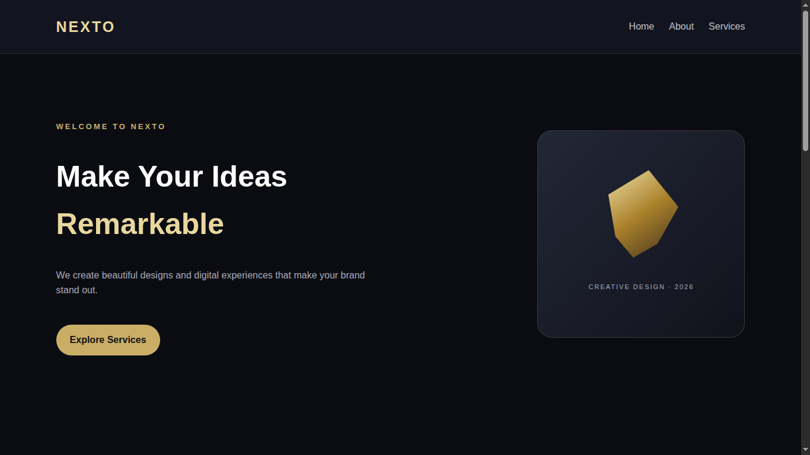
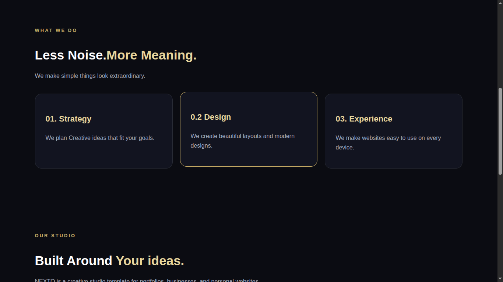
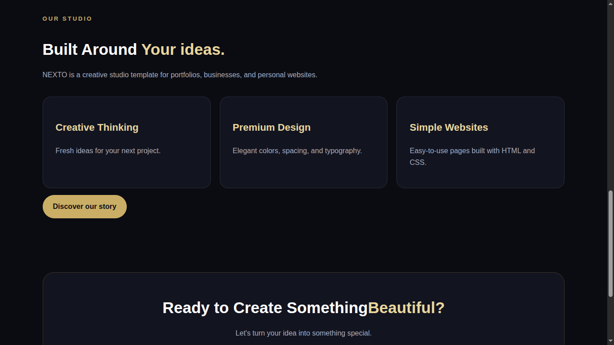
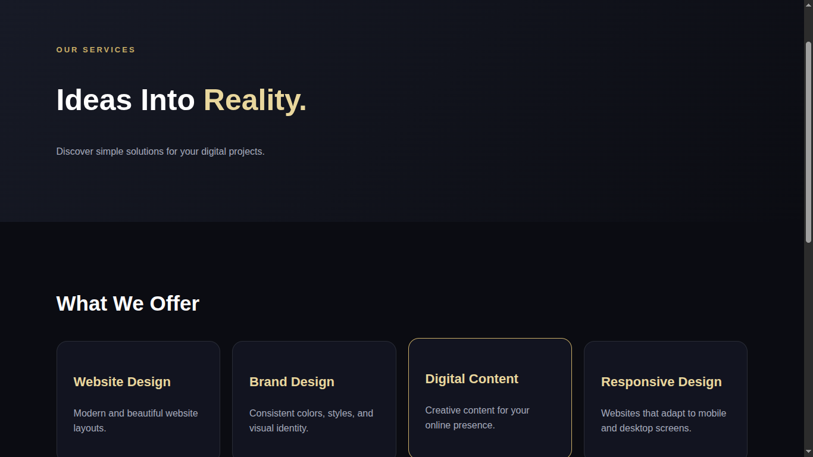
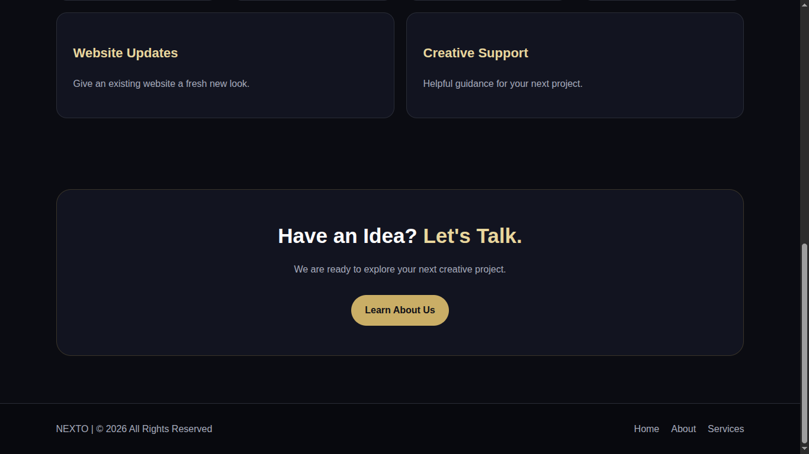
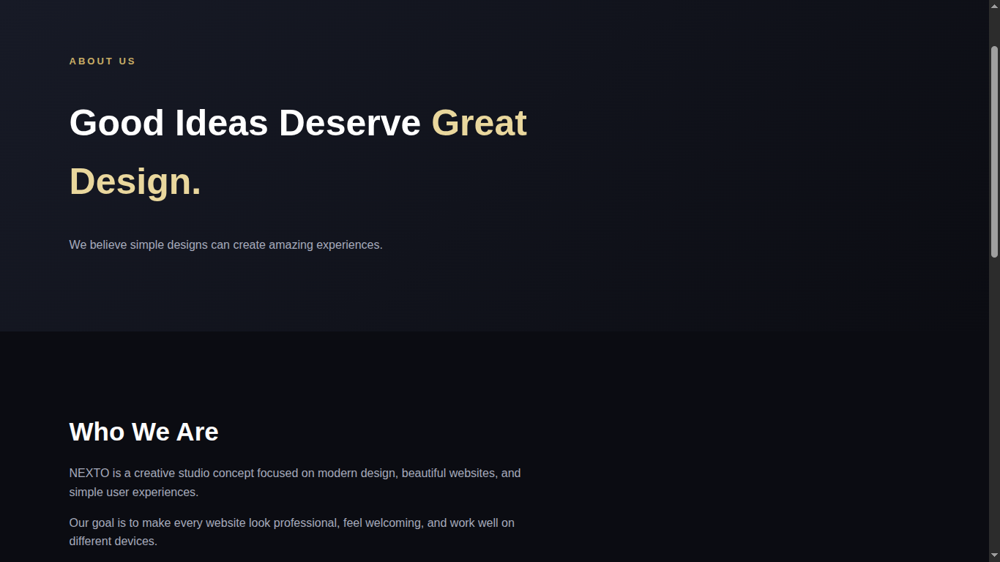
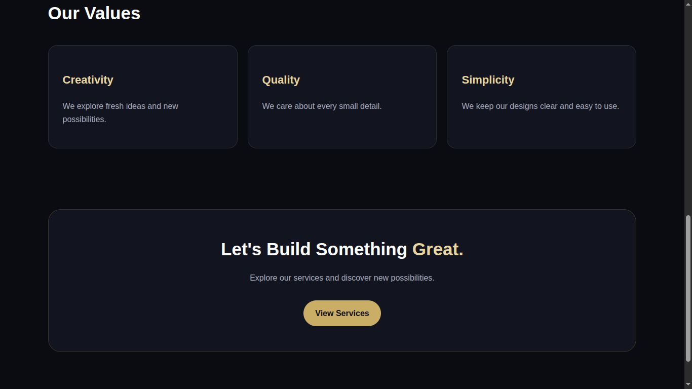

# NEXTO---WEBSITE

Hey! Welcome to NEXTO my new website . It is a demo premium textured , high quality , beginner level design of a website .It is designed as a designing development website . This is a web project I built from vscode using HTML, CSS  to create a beautiful, multi-page website .

I wanted to build something practical, Premium , and easy to navigate while experimenting with frontend web designing.

# What's Inside?

The project is structured with several connected pages and custom styling:

* index.html : The main homepage is very attractive and rich in css.
* about.html : An information page detailing what is the website for.
* services.html : It gives you the services we have.
* style.css : It is the main Styling css document for the index page . It gives colour,style and easy UI experience to the viewers  .

# Why I Built This

It is my second and first premium website i ever made also I created this project for sharpen my web development skills, practice  multi-page  websites with CSS styling. (I Think it will approve by my dear reviewers. please support me...)

# How To Open The Source code 

If you want to check it out or run it locally on your machine:
1. open and run the "index.html" file in your favourite browser .
2.Explore the different pages through the navigation links!

Hope you like my NEXTO , checking it out! And your Encouragement is my energy ( Hope @ ).

 ------THANKYOU------
# Screenshots
1. 
2. 
3. 
4. 
5. 
6. 
7. 

 
